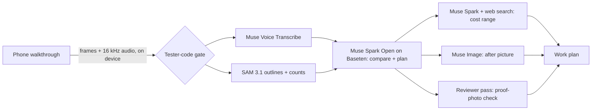

# SightWork

[](https://github.com/asjames18/sightwork-hackathon/actions/workflows/ci.yml)

**Built by Antonio James** for the Meta AI Developer Hackathon (Oct 26 – Nov 4, 2026), Startup track.

SightWork turns a short phone walkthrough of a property into a work plan you can act on. How long to film depends on how big the space is (see [Video length by room size](#video-length-by-room-size)).

## What it does
You film one walkthrough. SightWork returns:
- **Counts:** an inventory of what's in the space.
- **Ranked problems:** what needs attention, worst first and grouped into Fix now, Fix soon and Can wait, including issues the person filming never mentioned.
- **Worth a closer look:** lower-confidence finds kept in a separate list to check in person, instead of being dropped or padded into the ranked problems.
- **Proof frames:** the video frame behind each finding.
- **Materials:** what the work will need.
- **Order of work:** the steps, in the order they should happen.
- **Cost range:** a rough estimate of what the work will cost in your city and state, with material prices looked up live on the web and a line saying how many were.
- **After image:** an AI-generated picture of the finished space.

## How it works
SightWork is a multi-step agent where every model is a Meta model. Each step has one job:

| Step | Meta model | Where it runs | What it does |
|---|---|---|---|
| 0. Pick frames | (on the device) | Browser | Sharpest stills: about one per 1.25 s on takes up to 45 s, plus frames where the picture changes fast; about one every 2 s on longer takes; up to 48. Plus the narration as 16 kHz audio. The video never leaves the phone. |
| 1. Listen | **Muse Voice Transcribe** | Meta Model API | Narration to timestamped text, so SightWork knows what was said. |
| 2. Look and count | **SAM 3.1** | Meta Model API | Outlines and counts what's in the room, frame by frame. |
| 3. Compare and plan | **Muse Spark Open** (default) or **Muse Spark** | Meta open weights on Baseten, or Meta Model API | Sweeps the space zone by zone against a categorized checklist (life safety, electrical, AV, lighting, seating, flooring, walls, accessibility and more, plus extra checks for the space type picked), checks what was said against what was seen, ranks the problems (including ones nobody mentioned) with a proof frame each, then writes the materials and the ordered work steps. |
| 4. Price | **Muse Spark** with web search | Meta Model API | A rough cost range for the city and state: looks up material prices and the local labor rate on the web (searches batched, not one per item), and reports how many prices came from live search. The range itself is computed in code from those prices, so the math is reproducible. |
| 5. Picture | **Muse Image** | Meta Model API | An AI concept of the finished space, edited from the plan's hero frame, or the next frame that shows a ranked problem when the hero frame shows none. Existing logos, emblems, banners and wall art are kept exactly as they are. |
| 6. Review | same plan model, review only | as step 3 | Checks every problem against its proof photo and marks any it can't back as Unverified. Never edits the plan. |



SAM 3.1, Muse Image and the cost step are optional: when one is unavailable, the plan still comes back complete and says what was skipped. Every plan ends with a **Powered by Meta AI** panel listing each step, the Meta model behind it, where it ran, and whether it ran for that plan (hand-written samples say no model ran). The processing screen names the model under each step while it runs. A full run takes about 2 to 3 minutes and has cost $0.38 to $1.11 in model calls on real walkthroughs, most of it SAM 3.1 outlining about 300 frame and object pairs.

The plan and review calls run at temperature 0.2, so two runs on the same video stay closer together. When web search puts a sentence of prose ahead of the answer, the caller still finds the JSON answer in the response instead of failing the step.

More detail: [docs/ARCHITECTURE.md](docs/ARCHITECTURE.md). How the build maps to the judging criteria: [docs/JUDGING.md](docs/JUDGING.md).

## Video length by room size
Before filming, pick how big the space is. The size sets the recommended length, when the recorder says to wrap up, and where it stops by itself; a picked video longer than the size's cap is refused with a note to trim it or pick a bigger size. The rules live in one place, `ROOM_SIZES` in `src/lib/client/duration.ts`.

| Size | For example | Aim for | Wrap-up warning after | Cap (recorder stops) |
| --- | --- | --- | --- | --- |
| Small | Bedroom, office, bathroom | 30–60 s | 60 s | 75 s |
| Medium (default) | Classroom, kitchen, stage | 60–90 s | 95 s | 2 min |
| Large | Sanctuary, gym, big hall | 90 s–3 min | 2½ min | 3 min |
| Extra large | Warehouse, whole floor, parking lot | 3–5 min | 4½ min | 5 min |

Every size sends at most 48 frames, spread over the actual clip: takes up to 45 s get about one frame per 1.25 s, longer ones one every 2 s until that would pass 48, then evenly spread (about one every 2.5 s at 2 minutes, 3.8 s at 3 minutes and 6.4 s at 5 minutes). Anything under 5 seconds is refused for every size.

## Built during the hackathon
Everything in this repository was written during the event (Oct 26 – Nov 4, 2026). The idea and planning came before; no earlier code is included. Antonio built SightWork with AI coding assistance and deploys it himself.

## Running it
You need Node.js 20.9 or newer.

```bash
npm install
cp .env.example .env.local   # then add your own keys (see "Real runs"); .env.local is never committed
npm run dev
```
Then open http://localhost:3000 for the landing page, or http://localhost:3000/start to go straight to the app.
To check the TypeScript types without starting the app, run `npm run typecheck`.

To run the local checks, run `npm test` (Node 22.18 or newer, no extra packages). They cover the example plans (every image exists at the size the page reserves, every reference points at a real frame or problem, samples are labeled and credited), the upload screen's length check, the API runner's stream handling against a fake server, and the tester-code gate. Nothing in them calls a model or the network.

To run the browser checks, run `npm run e2e` (Playwright; run `npx playwright install chromium` once, or set `E2E_CHROME_PATH` to an installed Chrome). It builds the app, starts it locally with the example runner and every model key blanked, and walks landing → /start → example plan → upload a small test video → processing → plan, plus the 5-second minimum, the tester-code gate (in the browser and on the server), plan-screen keyboard use (section chips, before/after slider keys), Save PDF (a real PDF file: share sheet on a phone, download on a computer) and the print view, Open my last plan, the step check notes and the review line with an Unverified badge (on a stubbed run), the 404 page and /credits, the in-page recorder on Chromium's fake camera (a 1080p take at the 8 Mbps setting, cancel and blocked-camera fallbacks, WebM length), at 390 px and 1440 px with an axe accessibility scan on each screen. Every browser request to `/api` is blocked and fails the test, so it never calls a model. Set `E2E_SKIP_BUILD=1` to reuse the last build, or `E2E_BASE_URL` to test a server that's already running. It isn't part of `npm run build` or `npm test`.

GitHub Actions runs the typecheck, the unit tests and a production build with no keys on every push and pull request to `main` (see the badge at the top).

### Preview with example data (no API calls, no keys)
The example plans open without any keys. A video you record or choose is always sent as a real run (see "Real runs"), so your own walkthrough is never answered with an example plan. To walk the whole flow with example data instead, add `?runner=mock`; `?fail=` and `?mock=` below also use the example run. These links jump straight to a screen (older `/?view=` style links still work and redirect to `/start` with the query kept):
- `http://localhost:3000/start?view=example` opens the example plan.
- `?view=example&mock=nometa` shows a plan made without SAM outlines or an after picture.
- `?view=example&mock=nocost` shows a plan whose cost step failed.
- `?view=last` reopens the last finished plan on this device.
- `?runner=mock`, then upload any video: the processing screen plays the example run and ends on the example plan. Nothing is sent anywhere.
- `?mock=nometa` (without `view`), then upload any video: the processing screen runs with SAM and the after picture turned off. Looking and Counting flip to "skipped this run" once Comparing starts, the same timing as a real run with no Meta access.
- `?fail=<step>` (for example `?fail=planning`), then upload any video: the preview stops at that step with a failure message, so the error screen can be checked. Nothing is sent anywhere.

### Real runs
To send a walkthrough to the models, record or choose a video on `http://localhost:3000/start`. A real run needs the tester code the server is set up with (`SIGHTWORK_TEST_CODE`): if none is saved on the device yet, the video card asks for it and the run starts once it's saved, with the same video. A code the server refuses says so and asks again. Only an explicit `?runner=mock` or a build with `NEXT_PUBLIC_SIGHTWORK_RUNNER=mock` sends videos to the example run. The server reads these keys from the environment only:
- `BASETEN_API_KEY`: Muse Spark Open on Baseten, which writes the plan (the default, `PLAN_PROVIDER=baseten`).
- `META_API_KEY` (or `MODEL_API_KEY`): the Meta Model API for narration transcription, SAM 3.1 outlines and the Muse Image after picture. Set `PLAN_PROVIDER=meta` to run the planning steps on Muse Spark instead.

If SAM 3.1 or Muse Image isn't available to your key, those steps are skipped and the plan still comes back complete. Keys are never logged or committed.

Before a real run, the video card asks what kind of space it is (sanctuary, auditorium, fellowship hall, classroom, kitchen, office, hallway or another room; a sanctuary, classroom or kitchen also adds its own extra checks to the sweep) and an optional name, plus the city and state, which are required so the cost step prices materials and labor for that place. All three are kept on the device so someone filming the same building picks them once. The plan header, the PDF and the shared text show "Cost range for City, ST", and the plan keeps its city and state even when the cost step fails.

Each run is capped at $10 of model spend, enforced in code. The two paid routes also allow at most 30 requests per IP address per 10 minutes and answer 429 with a Retry-After header after that; requests the server rejects as malformed, and silent audio that is never sent to a model, don't count. If a call would push a run past the cap, the run stops with a failure message instead of moving on to the next step, and the calls it did make are logged on the server.

Once a picked video's length checks out, the video card measures a few frames on the device and warns, before anything is sent, when the take looks too dark to show damage (or blank), so a paid run isn't spent on it.

On /start, **Record a walkthrough** opens the camera in the page (back camera, asks for 1920×1080 at 30 fps with sound, records at about 8 Mbps, shows the size it actually got, says to wrap up at the room size's warning point and stops itself at its cap, 1:15 for Small up to 5:00 for Extra large). If the browser can't open the camera it falls back to the phone's camera app; **Choose a video** picks a file you already have. A Camera-app recording is usually still the sharpest.

While the in-page camera is open, the screen stays on (where the browser supports screen wake lock), so phone auto-lock can't end a take mid-walk. A small meter in the corner shows the mic level, and if a take has been quiet for 5 seconds a hint asks you to say what you see. With no mic at all, a note says the plan will use the video only. When the phone camera has a flashlight, a **Light on / Light off** button sits beside Cancel, usable before and during a take; cameras without one show no button. When the phone camera can zoom out below where it opened (many Android phones expose the ultra-wide lens as a 0.5x zoom), a **Wide view** button (with the phone's own zoom, e.g. "0.5x") sits beside them too, so one pass takes in more of a big room; tapping it again shows **Normal view**. Cameras without a wider lens in the browser, including most iPhones, show no button. On a narrow phone the buttons wrap onto a second row instead of pushing the page sideways.

SightWork can be added to a phone's home screen. It gets its own name and icon, opens straight to the recorder without browser bars, and a long press on the icon (on phones that support app shortcuts) offers Film a walkthrough, Open my last plan and See an example plan.

The in-page camera also checks the picture itself, twice a second, on the device (a small grey copy of the preview, no network and no model calls). If it stays too dark for 3 seconds it says "It's dark here. Turn on a light or point at the lit part of the room, so damage in the shadows shows up." If the picture keeps blurring for about 1.5 seconds compared with the take's usual sharpness, it says "Slow down a little. The picture is blurring, so pan slowly and pause on anything broken." A quick pass through a doorway or one fast turn doesn't trigger either. When the phone's light is available and off, the dark hint adds "Or tap Light on to use the phone's light."

A narrated run makes two requests. First the browser sends the narration as 16 kHz mono audio to `POST /api/transcribe`; then it sends still frames from the video (one about every 2 seconds, up to 48, longest side 1024 px) plus the transcript text to `POST /api/plan`. Narration recorded from arm's length in a big room is often very quiet, so before the audio is encoded the browser lifts a quiet take until its loud parts sit near full level (up to +24 dB, read from the loudest 0.1% so one click doesn't set it, never clipped and never turned down). Narration longer than about 80 seconds is cut into chunks of at most 80 seconds, each cut placed at the quietest moment in the last 12 seconds before the limit so no word is split, and each chunk goes to `/api/transcribe` in its own request; the browser then shifts each chunk's turn times by where the chunk starts and joins them, so the transcript times still match the video. If a transcribe request fails for any reason other than a bad tester code (one retry per chunk), the browser falls back to sending the audio along with the frames in one plan request when that fits, so narration is never dropped. The full video stays on the device.

The narration goes in its own request, so it doesn't eat into the frames' share of the plan request: a long narrated take keeps its full set of frames. The narration itself no longer has to fit one request: past about 80 seconds it goes in chunks (above), so even a 5-minute Extra large take fits a 4.5 MB host.

The browser keeps a request under about 9 MB, since the server accepts up to 10 MB. Some hosts cap request bodies lower (Vercel functions take 4.5 MB). On those, set `NEXT_PUBLIC_SIGHTWORK_MAX_REQUEST_BYTES` at build time (for example `4300000`), and the browser softens the frames to fit or says the take is too long up front, instead of the host rejecting it.

A brief gateway error from the plan model (502, 503 or 504) is retried up to three times, a second and then two seconds apart, before the step fails; a failed attempt costs nothing.

Each request logs one usage line on the server with its model calls and cost: one from the transcribe route and one from the plan route. The transcribe route also returns its cost (on success and on a failed billed call), and the browser adds it to the plan's own total, so the run-cost line on a real plan covers the whole run.

While a plan runs, the processing screen shows each step with the model behind it, a running clock beside "Step N of M", and how long each finished step took. With a city and state, the Planning row says Muse Spark is pricing materials and labor for that place with web search. A time line under the clock comes from measured real runs: "Usually 2 to 3 minutes" (about 3 with live prices for the place), then "Taking a little longer than usual" past 3.5 minutes and a near-limit note past 4.5 minutes, since the server stops a run at 5. The phone screen stays on until the run ends, and the browser tab title shows the current step. On a real run, if the phone loses its connection, a note says so ("You're offline. The plan needs a connection to finish…") and clears when it comes back; if the run stops while offline, the Stopped card says to reconnect, then tap Try again. Example runs need no network and show no note. When the plan is ready, phones that can vibrate (most Android browsers; not iPhone Safari) give two short buzzes, skipped if reduced motion is on, and a tab in the background says "Plan ready" in its title. A "What your plan will have" list (problems including ones you didn't mention, counts, work steps, materials, cost range) sits beside the steps on computers and folds under them on phones.

Each finished step can carry a short check note under it ("Checked: …", or "Flagged: …" when something looked off, such as a count with no outline or a problem without a proof frame), and the last step is **Reviewing**. The reviewer is review-only: a separate pass looks at each problem next to its proof photos and marks any it can't back with a photo as **Unverified**, with a one-line reason. It never rewrites the plan. The plan then shows "Reviewed by a separate check: N of M problems backed by a photo." above the problems, and an Unverified badge on each problem it couldn't back; that carries into Save PDF and the shared text. If the review doesn't run, the plan says so instead of implying everything was checked. The example plans carry a review worked out ahead of time from their own proof photos (no model runs), and say that. On real runs the check notes and the review appear once the server sends them; without them the plan shows neither.

On the plan screen:
- **The summary card** under the title lists the problems one per line with their number (the first four, then "+N more below"; on narrated runs, the ones nobody mentioned). Each line links straight to that problem's card and proof frame, and the stats row opens the problem list. A problem card or work step reached from any link on the plan lights up for a moment so the eye lands on it (a still outline with reduced motion). A real or reopened plan also names its space in the browser tab ("Sanctuary stage plan | SightWork").
- **Back to top:** once you're about a screen and a half down a long plan, a Back to top button sits in the bottom-right corner; it returns to the plan title and moves keyboard focus there (no animation with reduced motion, hidden in print).
- **Back to where you were:** after you tap a link that jumps between a step and a problem (a step's "Fixes #2" chip, a problem's "Fixed in step 3", a summary or shopping-list problem number), a "Back to step 1" or "Back to problem #4" button sits in the bottom-left corner. It returns to the spot you left and puts focus back on the link you tapped, and goes away once used or once you scroll back yourself (hidden in print).
- **Section chips** stay at the top while you scroll: Problems, Counts, Steps and Materials (plus Said vs saw on narrated runs and Cost when there is a range). Each chip carries how many that part holds ("Problems 4", "Steps 4"; 99+ for long lists, just the name when empty), and the chip for the part on screen is marked. Once you tick steps or shopping-list items, those two chips show progress instead ("Steps 2/4", "Materials 3/7"), following the ticks live, and once a ticked step fixes a problem the Problems chip shows how many of the problems a step fixes are done ("Problems 1/4").
- **Start here** sits right under the summary stats when some problems are Fix now: it names the few steps that take care of them (plus any earlier step they wait on), each a link down to the step, with their hours, trades and share of the estimate, and says when a Fix now problem has no step yet. The same sentence goes into the shared text and Save PDF.
- **Next up:** once any step is ticked off, a card under Start here names the next step that's ready (whatever it waits on is done), who does it, about how long and whether its materials are in hand, with a link to the step, a **Mark step N done** button and **Send this step**; after **Mark step N done** a short "Marked step N done." line with **Undo** takes back a mis-tap (it goes away once anything else is ticked); it turns into "Work order done" at the end. The shared text and Save PDF add the same "Next up" line.
- **Send the counts** under the What's there tiles shares just the counts (count or range, area, how counted, check-by-hand flags) for whoever orders and sets up.
- **Send just one part.** Each problem card has **Send this problem** and each work step **Send this step**; on phones whose share sheet takes files, both attach the proof photo with the problem outlined as on screen ("Photo attached, with the problem outlined."), and text only otherwise. With the **You didn't mention** or **Still to fix** filter on, **Send these N** shares just the problems shown. **Send the cost** at the bottom of the cost card shares the range for the city and state, the labor basis, where the prices came from, the biggest steps or problems by cost, and the main assumptions, for whoever approves the spend. Example plans are labeled as examples in every shared text.
- **Each count says how it was made:** "Counted from SAM 3.1 outlines", "SAM 3.1 outlines and the model agree", "SAM 3.1 outlines and the model differ, so a range" or "Estimated by the model from the frames" (never a SAM claim when outlines were skipped that run). A count under 0.5 confidence adds "Low confidence, check by hand". Save PDF prints the same lines.
- **Along your walk** is one bar the length of the video with a dot for each problem at the second it was seen, colored Fix now, Fix soon or Can wait. On narrated runs a small mic tick marks where something was said, and a ring marks a problem nobody mentioned. Each dot links down to its problem card. Save PDF and the shared text carry the same walk in words: a one-line summary, then the problems in the order they were seen, with their seconds and a never-mentioned mark.
- **Long walks keep their areas:** frames are grouped into areas of the space before the plan step; on Large and Extra large takes, a frame that sits 4 s or more from its neighbours keeps its own area unless it looks like the one next to it, so a long walk doesn't merge rooms or lose counts.
- **Problems are grouped by how soon to act:** Fix now (safety), Fix soon (damage that grows, things that don't work) and Can wait (cosmetic), worst first inside each group. Each problem can show where it is, what its photo literally shows, and its share of the cost range.
- **The cost card says where its prices came from:** for example "All 3 material prices looked up live on the web for Atlanta, GA." or "5 of 7 … the rest are regional estimates." The same line goes into Save PDF and the shared text. Example plans and older plans don't show it.
- **The cost card keeps up with the work:** when the plan splits the cost by step and some steps are ticked off, the card adds a line like "About $700–$1,522 of this is for the 3 steps not ticked yet." so whoever approves the spend sees what is still ahead. It updates with every tick and goes away once every step is done.
- **Worth a closer look** (collapsed) lists the lower-confidence finds with their photos. Opened, **Send these to check** hands the list, with what to look for, to whoever checks them in person. Each find has a **Mark checked** toggle, kept on the device, so the list shows how many were checked ("1 of 2 checked in person.") and the sent list marks the checked ones. When a plan has fewer than three problems, a short note says why (for example, only the stage was filmed).
- **Run cost:** on real plans the Powered by Meta panel says what the model calls cost ("The AI model calls for this plan cost about 94 cents."), and the same line goes into Save PDF and the shared text. Example plans don't show it. The total covers the whole run, including the separate narration transcription. If a run stops partway, the Stopped screen says what the calls before it stopped cost ("about 21 cents"); nothing billed means no line.
- **Send to your team** shares the plan as plain text: the phone's share sheet on touch devices, the clipboard elsewhere. The text follows the screen (problems worst first, a short "What's there" line with up to five counts and how they were counted, work steps in order, materials, and the cost range with its "rough estimate, not a quote" label). The counts line is the first thing left out when a text runs long.
- **Problems and steps link both ways.** Each problem card says which step fixes it ("Fixed in steps 3 and 4", each number a link down to that step), and each step's "Fixes #1, #2" chip links back up to the problem cards. A step that others wait on gets a "Step 4 waits on this" chip, and Send this step, the calendar file, the crew handout and Save PDF say which steps can start once it's done. Each step also shows whether its materials are in hand ("2 of 3 items in hand"), live with the shopping list ticks.
- **What you said vs. what we saw** (narrated runs) puts the narration next to what the frames show, including problems nobody mentioned. When the list has both kinds of rows, **Show only what you didn't mention** narrows it to just the catches in one tap. It also goes into Save PDF and the shared text.
- **You didn't mention:** on narrated runs the summary stats count the problems the video caught that nobody said, and the Problems list has an **All / You didn't mention** filter that shows just those in one tap. The shared text and Save PDF lead with the same count ("2 of 5 never mentioned on the walk, caught on video."), and the PDF names them under its summary.
- **Who does the work** opens the work order: each paid trade with its step numbers and summed hours, then volunteers, then any step with no trade. Each crew row has a **Send** button that shares just that crew's part: their steps in order with detail, hours, which problems each fixes and which earlier step to wait for. The same rows go into Save PDF.
- **Since your last walkthrough:** when this device has an earlier real plan of the same space in the same city and state, a card compares the two: no longer seen, still there and new this time, each with its fix-now / fix-soon / can-wait tier. Problems are matched by what they are, where they are and what they're called, so the card says it's a best guess to check on site. The comparison also goes into the shared text and Save PDF. Example plans never compare.
- **Work steps are a checklist.** Tick each step as it's done; ticks are saved on this device for that plan, so a crew lead can come back to it later. Once some are ticked, a line under the progress shows about how many hours of work are left on the rest. "Clear ticks" resets them, with an Undo right after that puts the same ticks back (the shopping list works the same way). "Hide the N done" tucks finished steps away so the crew sees only the work left; a link to a hidden step brings every step back and lands on it, and paper always lists every step. **Send the N steps left** shares just the steps not ticked yet, in order, with who does each, rough hours and what each fixes, for whoever picks the work up next. Ticks show across the plan: the Start here card checks off done steps and counts them, each problem card gets a "Step done" chip once every step that fixes it is ticked, and the shared text adds a progress line (for example "Progress: 2 of 4 steps ticked off as done").
- **Add to calendar** downloads the work steps as a standard calendar file (.ics): steps back to back on weekdays, 9 AM to 5 PM, starting the next workday, each event saying which problems it fixes. Each crew row in Who does the work has its own Calendar button with only that crew's steps at the same times, and the crew's Send text gives each step a "When:" line. Save PDF prints a schedule line ("Starts Mon, Nov 2, 9 AM; 3 workdays, 9 to 5.") and a When line under each step, and the shared text gets the schedule line, all on the same schedule as the calendar file. No model calls.
- **Materials are a shopping list.** Tick each item as you get it (saved on this device for that plan), see how many are in hand, a "Materials to buy: about $X–$Y for N items" line for what's still needed (and how many have no price yet), also printed in Save PDF, and **Send shopping list** shares only what's still needed, with quantities, the problems each item fixes and the per-unit estimate. Each material also says which work step first needs it and when that step starts on the plan schedule ("Needed by step 2, Mon, Nov 2, 9 AM"), with a "Buy first" line naming what step 1 needs; the shopping list text and Save PDF carry the same lines. Once some items are in hand, "Hide the N in hand" tucks them away so a long list in the store shows only what's left (Show all brings them back; paper always lists every item).
- **Save PDF** makes a real PDF file in the browser (jsPDF, loaded on first use): title, city and state, date, counts, problems worst first with their proof photos and outlines, steps in order, materials, the cost range with its estimate label, the after picture, and a sample label on example plans. On phones it opens the share sheet with the file (Save to Files, Messages, Mail); on computers it downloads `sightwork-plan-<space>-<date>.pdf`. The print view stays as the fallback.
- **Send to your team** sends a short text (space, city and state, date, problems in plain words, steps, materials, cost) and, on phones that can share files, attaches the same PDF so the proof photos go with it.

On /start, **Your recent plans** lists the last 5 finished real runs on this device (space, city and state, date, problem count): tap one to reopen it, or remove it (an Undo right under the list puts it back). Example plans are never listed.

### Status page
`/status` shows whether the site is up, which build is live, whether real runs are on, and whether the plan engine and the Meta Model API are configured, as presence checks only (no key, code or URL is ever shown). It makes no model calls, so it costs nothing to check. It also lists the safeguards that are always on.

### Eval
`npm run eval` scores plans against labeled answer keys in `tools/eval/keys/` (recall, recall on high-severity items, precision, and whether the #1 problem is a high-severity one). It is offline and deterministic (keyword matching on each problem's title and detail), and `npm test` holds the real sanctuary run to its baseline so a prompt or pipeline change that loses a known hazard fails the checks. Today's baseline on the real sanctuary run: recall 0.8, high-severity recall 1.0, precision 1.0. The key is a draft labeled from the run's frames; confirm on site before treating it as ground truth.

## Status
Every step runs end to end on a real walkthrough: frames and narration in, a full plan with SAM counts and an after picture out. Polish continues through the end of the hackathon.

## License

MIT. See [LICENSE](LICENSE).
