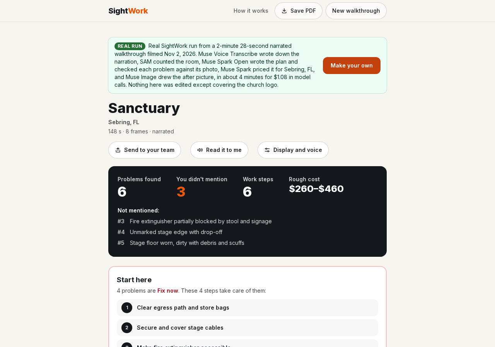
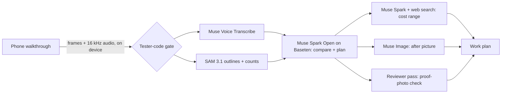

# SightWork

[](https://github.com/asjames18/sightwork-hackathon/actions/workflows/ci.yml)

**Built by Antonio James** for the Meta AI Developer Hackathon (Oct 26 – Nov 4, 2026), Startup track.

## Try it
**Live app: [sightwork.melanatedintech.com](https://sightwork.melanatedintech.com)**

- Open the **sanctuary example plan** (a real run on a narrated walkthrough, no code or sign-in needed): [sightwork.melanatedintech.com/start?view=example&ex=sanctuary](https://sightwork.melanatedintech.com/start?view=example&ex=sanctuary).
- Running a new walkthrough through the models needs a tester code (this keeps model spend under control). Judges and reviewers who need one can ask Antonio James.
- **Demo video:** [Watch the 2:24 demo on YouTube](https://youtu.be/8ws8nVdm9T8)



## Meta AI models used
Every model in SightWork is a Meta model:
- **Muse Voice Transcribe** turns the narration into timestamped text.
- **SAM 3.1** outlines and counts what's in the room, frame by frame.
- **Muse Spark Open** compares what was said with what the frames show, ranks the problems, and writes the materials and the ordered work steps (it also runs the review-only pass that checks each problem against its proof photo).
- **Muse Spark** (with web search) prices materials and labor for the city and state.
- **Muse Image** draws the "after" picture of the finished space.

The full step-by-step table is in [How it works](#how-it-works).

## Run it yourself
You need Node.js 20.9 or newer.

```bash
git clone https://github.com/asjames18/sightwork-hackathon.git
cd sightwork-hackathon
npm install
npm run dev
```
Open http://localhost:3000. Add `?runner=mock` to `/start` to walk the whole flow with example data and no keys. For real runs, copy `.env.example` to `.env.local` and add your own Meta Model API and Baseten keys (see [Real runs](docs/DETAILS.md#real-runs)). Keys are read from the environment only and are never committed.

SightWork turns a short phone walkthrough of a property into a work plan you can act on. How long to film depends on how big the space is (see [Video length by room size](#video-length-by-room-size)).

## What it does
You film one walkthrough. SightWork returns:
- **Counts:** an inventory of what's in the space.
- **Ranked problems:** what needs attention, worst first and grouped into Fix now, Fix soon and Can wait, including issues the person filming never mentioned.
- **Worth a closer look:** lower-confidence finds kept in a separate list to check in person, instead of being dropped or padded into the ranked problems.
- **Proof frames:** the video frame behind each finding.
- **Materials:** what the work will need.
- **Order of work:** the steps, in the order they should happen.
- **Cost range:** a rough estimate of what the work will cost in your city and state, with material prices looked up live on the web and a line saying how many were.
- **After image:** an AI-generated picture of the finished space.

## How it works
SightWork is a multi-step agent where every model is a Meta model. Each step has one job:

| Step | Meta model | Where it runs | What it does |
|---|---|---|---|
| 0. Pick frames | (on the device) | Browser | Sharpest stills: about one per 1.25 s on takes up to 45 s, plus frames where the picture changes fast; about one every 2 s on longer takes; up to 48. Plus the narration as 16 kHz audio. The video never leaves the phone. |
| 1. Listen | **Muse Voice Transcribe** | Meta Model API | Narration to timestamped text, so SightWork knows what was said. |
| 2. Look and count | **SAM 3.1** | Meta Model API | Outlines and counts what's in the room, frame by frame. |
| 3. Compare and plan | **Muse Spark Open** (default) or **Muse Spark** | Meta open weights on Baseten, or Meta Model API | Sweeps the space zone by zone against a categorized checklist (life safety, electrical, AV, lighting, seating, flooring, walls, accessibility and more, plus extra checks for the space type picked), checks what was said against what was seen, ranks the problems (including ones nobody mentioned) with a proof frame each, then writes the materials and the ordered work steps. |
| 4. Price | **Muse Spark** with web search | Meta Model API | A rough cost range for the city and state: looks up material prices and the local labor rate on the web (searches batched, not one per item), and reports how many prices came from live search. The range itself is computed in code from those prices, so the math is reproducible. |
| 5. Picture | **Muse Image** | Meta Model API | An AI concept of the finished space, edited from the plan's hero frame, or the next frame that shows a ranked problem when the hero frame shows none. Existing logos, emblems, banners and wall art are kept exactly as they are. |
| 6. Review | same plan model, review only | as step 3 | Checks every problem against its proof photo and marks any it can't back as Unverified. Never edits the plan. |



SAM 3.1, Muse Image and the cost step are optional: when one is unavailable, the plan still comes back complete and says what was skipped. Every plan ends with a **Powered by Meta AI** panel listing each step, the Meta model behind it, where it ran, and whether it ran for that plan (hand-written samples say no model ran). The processing screen names the model under each step while it runs. A full run takes about 2 to 3 minutes and has cost $0.38 to $1.11 in model calls on real walkthroughs, most of it SAM 3.1 outlining about 300 frame and object pairs.

The plan and review calls run at temperature 0.2, so two runs on the same video stay closer together. When web search puts a sentence of prose ahead of the answer, the caller still finds the JSON answer in the response instead of failing the step.

More detail: [docs/ARCHITECTURE.md](docs/ARCHITECTURE.md). How the build maps to the judging criteria: [docs/JUDGING.md](docs/JUDGING.md).

## Video length by room size
Before filming, pick how big the space is. The size sets the recommended length, when the recorder says to wrap up, and where it stops by itself; a picked video longer than the size's cap is refused with a note to trim it or pick a bigger size. The rules live in one place, `ROOM_SIZES` in `src/lib/client/duration.ts`.

| Size | For example | Aim for | Wrap-up warning after | Cap (recorder stops) |
| --- | --- | --- | --- | --- |
| Small | Bedroom, office, bathroom | 30–60 s | 60 s | 75 s |
| Medium (default) | Classroom, kitchen, stage | 60–90 s | 95 s | 2 min |
| Large | Sanctuary, gym, big hall | 90 s–3 min | 2½ min | 3 min |
| Extra large | Warehouse, whole floor, parking lot | 3–5 min | 4½ min | 5 min |

Every size sends at most 48 frames, spread over the actual clip: takes up to 45 s get about one frame per 1.25 s, longer ones one every 2 s until that would pass 48, then evenly spread (about one every 2.5 s at 2 minutes, 3.8 s at 3 minutes and 6.4 s at 5 minutes). Anything under 5 seconds is refused for every size.

## Built during the hackathon
Everything in this repository was written during the event (Oct 26 – Nov 4, 2026). The idea and planning came before; no earlier code is included. Antonio built SightWork with AI coding assistance and deploys it himself.

## Full details
Setup and test commands, preview links, how real runs work, every plan screen feature, and the status page: [docs/DETAILS.md](docs/DETAILS.md).

## Eval
`npm run eval` scores plans against labeled answer keys in `tools/eval/keys/` (recall, recall on high-severity items, precision, and whether the #1 problem is a high-severity one). It is offline and deterministic (keyword matching on each problem's title and detail), and `npm test` holds the real sanctuary run to its baseline so a prompt or pipeline change that loses a known hazard fails the checks. Today's baseline on the real sanctuary run: recall 0.8, high-severity recall 1.0, precision 1.0. The key is a draft labeled from the run's frames; confirm on site before treating it as ground truth.

## Status
Every step runs end to end on a real walkthrough: frames and narration in, a full plan with SAM counts and an after picture out. Polish continues through the end of the hackathon.

## License

MIT. See [LICENSE](LICENSE).
