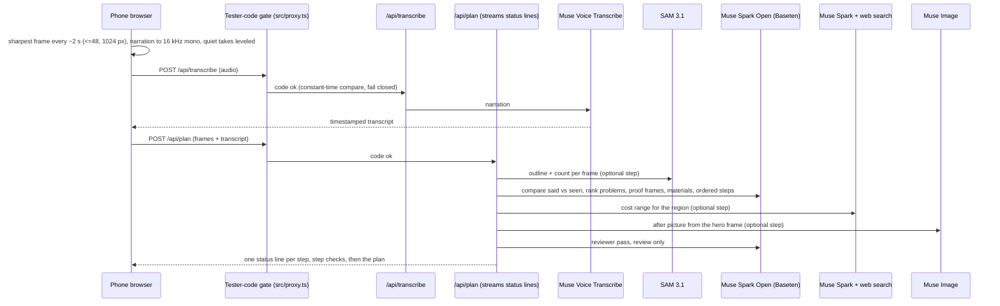

# SightWork architecture

One phone walkthrough in, one work plan out. Every model in the run is a Meta model.

## Request flow

## Where the code lives

| Area | Path | Notes |
|---|---|---|
| Device-side capture | `src/lib/client/*`, `src/components/CameraRecorder.tsx`, `UploadStep.tsx` | Frame sampling, sharpest-of-neighbours pick, narration extraction and leveling, size budget, blank-take check. The video never leaves the device. |
| Gate | `src/proxy.ts` | Every `/api/**` request needs the tester code; no code set on the server means every API request gets 401. |
| Pipeline | `src/lib/pipeline/*` | `runPlan` orders the steps, validates every model output, enforces the per-run spend cap before each call, and marks optional steps as skipped instead of failing. |
| Meta callers | `src/lib/meta/*` | Meta Model API (Transcribe, SAM 3.1, Muse Spark, Muse Image) and Baseten (Muse Spark Open). Retries for gateway 502/503/504 and Meta `model_not_found` blips. |
| Plan screen | `src/components/PlanView.tsx` and friends | Problems worst first with proof frames, said vs saw, counts, ordered steps (a checklist), materials (a shopping list), cost, before/after, Save PDF, share, and the Powered by Meta AI panel (`src/lib/metaCredits.ts`). |
| Status | `src/app/status/page.tsx`, `src/lib/status.ts` | Presence-only config checks and the always-on safeguards. No model calls. |
| Eval | `tools/eval/*` | Offline scoring of plans against labeled answer keys. |

## Reliability

- **Optional steps degrade, the plan still ships.** SAM 3.1, Muse Image and the cost step can each fail or be unavailable; the plan comes back complete and the Powered by Meta AI panel shows the step as off.
- **Retries.** The plan model retries gateway errors (502, 503, 504) up to 3 times, 1 s then 2 s apart; a failed attempt costs nothing. Meta `model_not_found` responses get a short backoff.
- **Spend cap in code.** The usage tracker refuses any call that would push the run past its cap, and logs every call's model, step, cost and latency.
- **Validation everywhere.** Frame and audio size caps are checked in the browser and again on the server before any call; model output is schema-checked before the next step reads it.
- **Review, never rewrite.** The reviewer pass only labels problems it can't back with a photo as Unverified.
- **Tests.** `npm test` (offline unit tests, including the eval baseline) and `npm run e2e` (Playwright at phone and desktop widths with an axe scan on every screen; any browser request to `/api` fails the test).
